# All Parameters Set: Partial vs Full (Route Time Sensitivity)

Mean % improvement = (full - partial) / partial × 100. Feasible in both.

---

## Combined View (Partial vs Full)

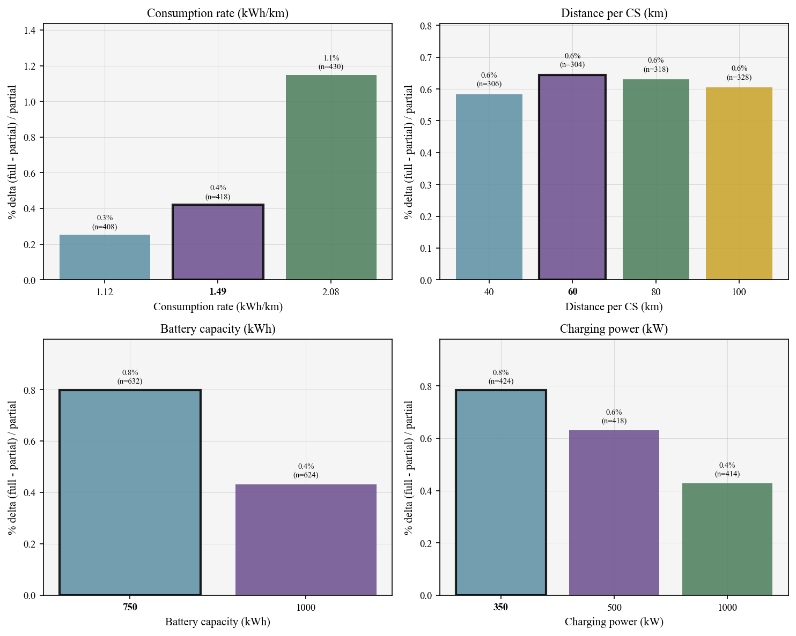

## Full recharge vs diesel proxy (by parameter)

Paired gap g = 100×(T^full−T^diesel)/T^diesel per scenario; T^diesel is one value per structural route instance. Means are over paired feasible scenarios at each parameter level.

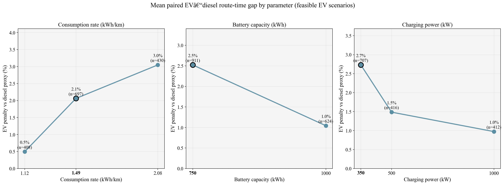

## Full recharge vs diesel proxy (station spacing — penalty)

Mean paired EV–diesel route-time gap by station spacing (base-case EV settings, 60–300 km).

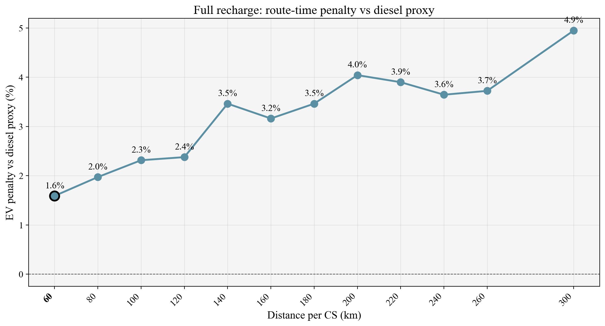

## Full recharge vs diesel proxy (station spacing — feasibility)

Full-recharge feasibility rate by station spacing (same sweep).

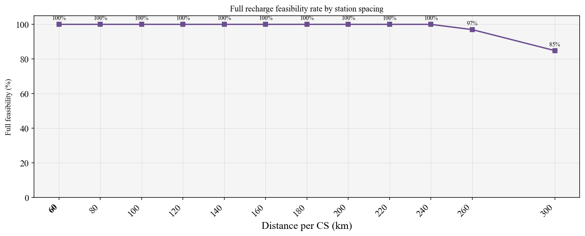

## Partial recharge vs diesel proxy (by parameter)

Same paired instance-level diesel benchmark as full vs diesel.

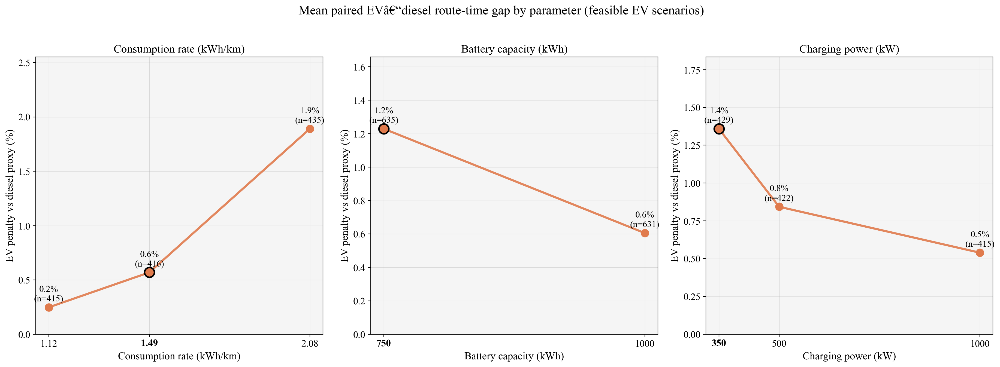

## Partial recharge vs diesel proxy (station spacing — penalty)

Mean paired EV–diesel route-time gap by station spacing.

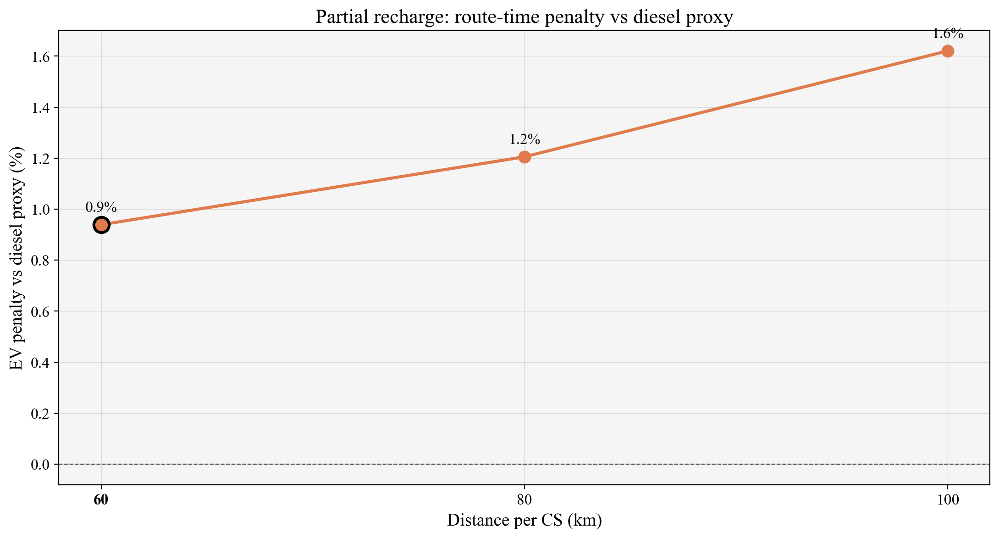

## Partial recharge vs diesel proxy (station spacing — feasibility)

Partial-recharge feasibility rate by station spacing.

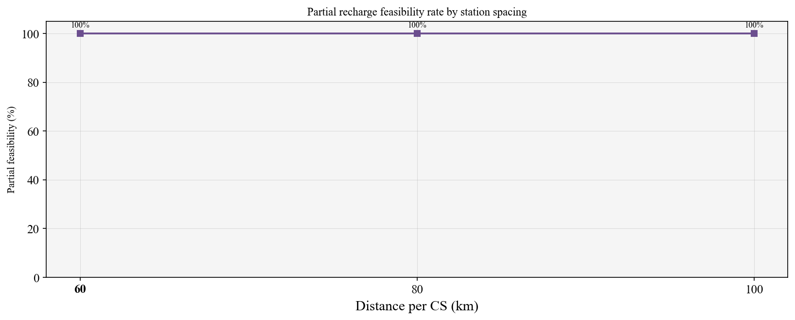

---

## Consumption rate (kWh/km)

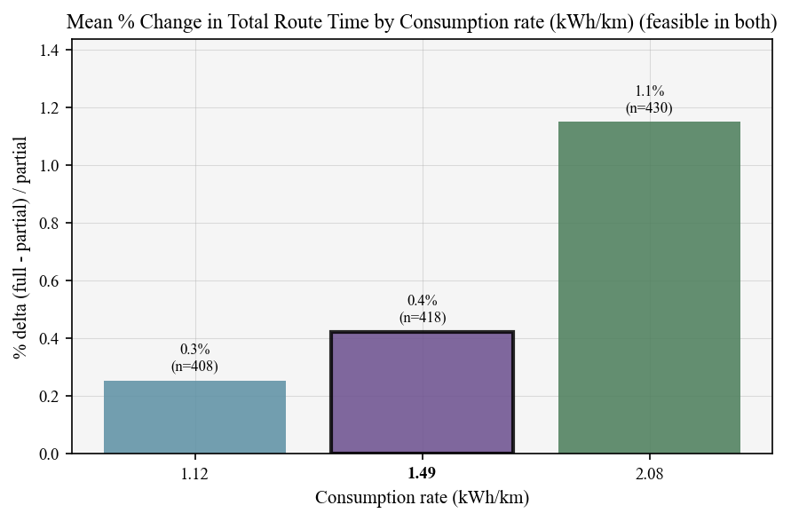

| Value | Mean improvement % | Std | N |
|-------|-------------------|-----|---|
| 1.12 | 0.25 | 0.12 | 408 |
| 1.49 | 0.42 | 0.29 | 418 |
| 2.08 | 1.15 | 1.55 | 430 |

## Distance per CS (km)

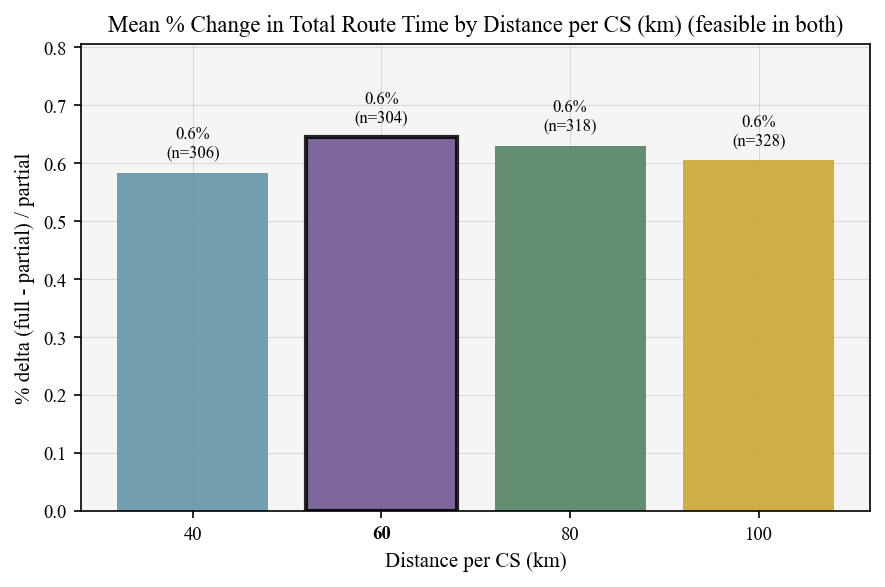

| Value | Mean improvement % | Std | N |
|-------|-------------------|-----|---|
| 40.0 | 0.58 | 0.65 | 306 |
| 60.0 | 0.64 | 0.68 | 304 |
| 80.0 | 0.63 | 1.28 | 318 |
| 100.0 | 0.60 | 1.21 | 328 |

## Battery capacity (kWh)

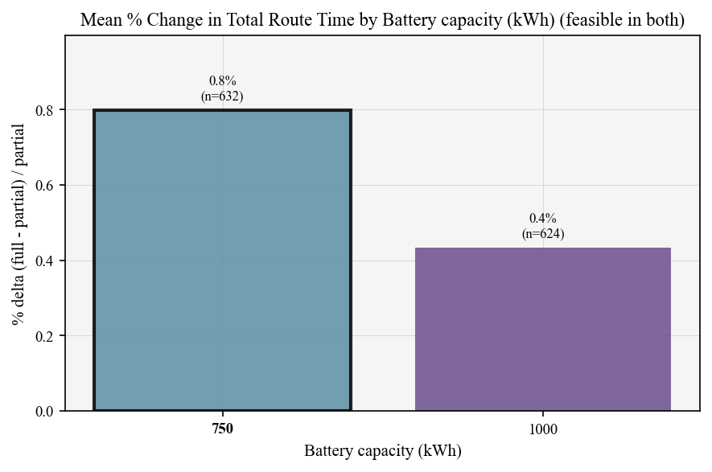

| Value | Mean improvement % | Std | N |
|-------|-------------------|-----|---|
| 750.0 | 0.80 | 1.32 | 632 |
| 1000.0 | 0.43 | 0.44 | 624 |

## Charging power (kW)

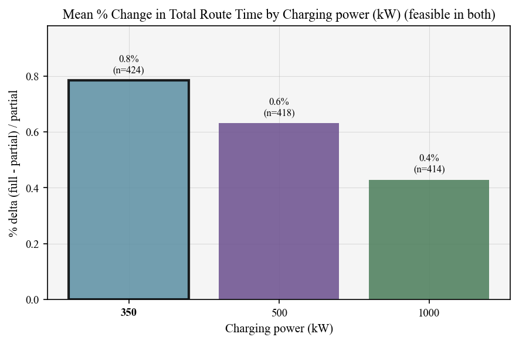

| Value | Mean improvement % | Std | N |
|-------|-------------------|-----|---|
| 350.0 | 0.78 | 1.60 | 424 |
| 500.0 | 0.63 | 0.57 | 418 |
| 1000.0 | 0.43 | 0.23 | 414 |

---

## Charging Synchronization

Per test: num_charges, num_synchronized, num_unsynchronized, num_sync_with_break, num_sync_with_rest. Box plots by parameter.

**Table:** `tables/table_charging_sync.csv`
**Figures:** `charging_boxplot_*.png`

**Figures:** `figures/`
**Tables:** `tables/`