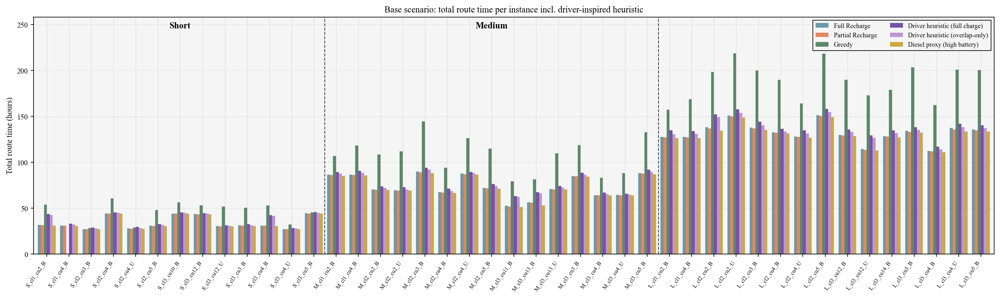
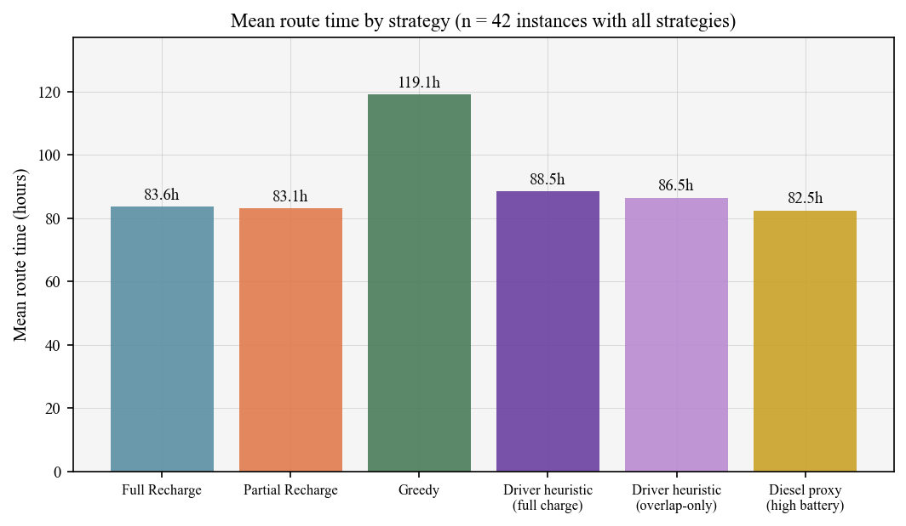
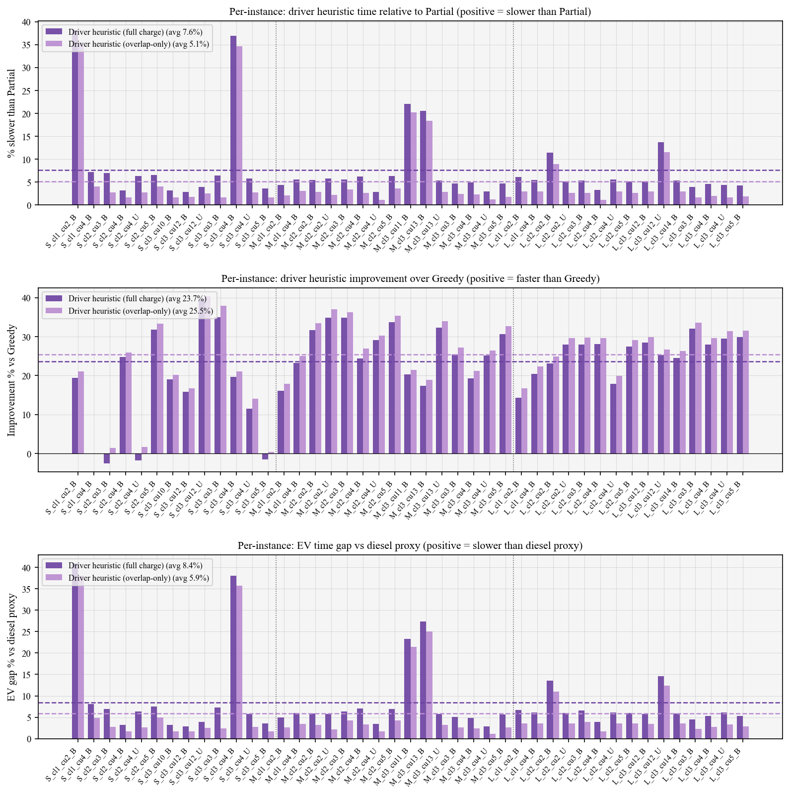
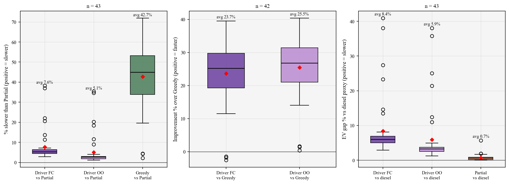
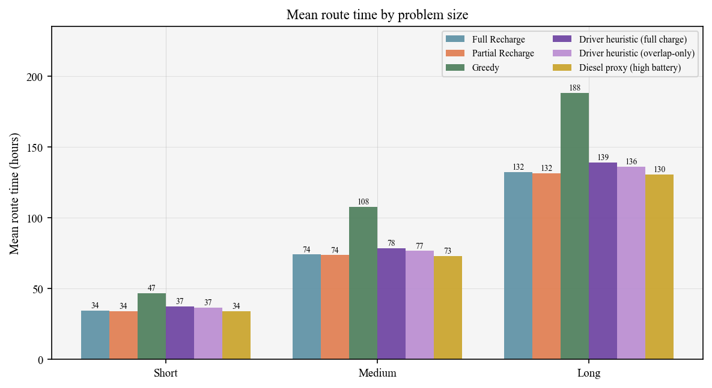
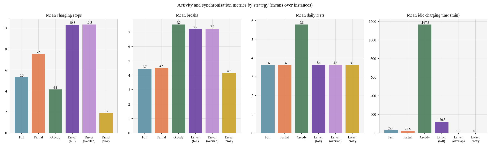
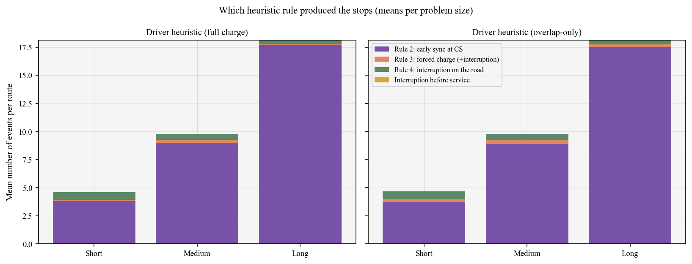
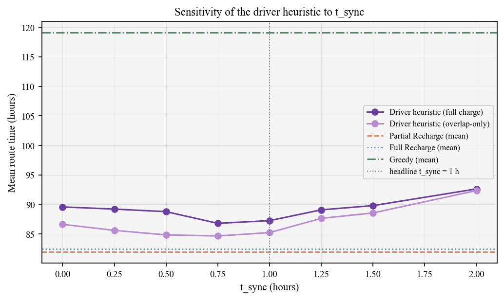

# Base-scenario post-analysis: driver-inspired sequential heuristic

Driver heuristic results: `details.jsonl` (t_sync = 1.0 h; policies: full charge = `Driver_FC`, overlap-only = `Driver_OO`).
EV configuration: battery 750 kWh, CS spacing 60 km, charging power 350 kW, consumption 1.49 kWh/km. Diesel proxy = partial_labeling with very large battery (unconstrained lower bound). Greedy uses the appended/unified greedy run parameters (may differ if greedy comes from another export).
Instances compared: 43. Infeasible driver-heuristic rows dropped: 0.

**Note on Greedy:** the Greedy rows in the base-scenario folder were run with charging power [150.0] kW, not 350 kW; Greedy comparisons are therefore not at identical charging power.

## 1. Summary of comparisons (candidate advantage over reference = (ref - cand)/ref)

| Comparison | n | mean_reference_h | mean_candidate_h | candidate_better | reference_better | candidate_advantage_avg | candidate_advantage_min | candidate_advantage_max |
| --- | --- | --- | --- | --- | --- | --- | --- | --- |
| Partial vs Driver (full charge) | 43 | 87.255 | 81.929 | 43 | 0 | 6.67% (319.57 min) | 3.81% (71.74 min) | 12.05% (933.50 min) |
| Partial vs Driver (overlap-only) | 43 | 85.227 | 81.929 | 43 | 0 | 4.41% (197.92 min) | 1.58% (29.67 min) | 10.35% (786.36 min) |
| Full vs Driver (full charge) | 43 | 87.255 | 82.428 | 43 | 0 | 6.10% (289.63 min) | 2.49% (46.82 min) | 11.49% (890.30 min) |
| Full vs Driver (overlap-only) | 43 | 85.227 | 82.428 | 42 | 1 | 3.83% (167.97 min) | -0.00% (-0.05 min) | 9.78% (743.16 min) |
| Driver (full charge) vs Greedy | 42 | 119.149 | 88.543 | 39 | 3 | 23.66% (1836.33 min) | -2.55% (-43.40 min) | 32.05% (3913.50 min) |
| Driver (overlap-only) vs Greedy | 42 | 119.149 | 86.49 | 42 | 0 | 25.45% (1959.49 min) | 0.41% (11.07 min) | 33.51% (4090.99 min) |
| Driver overlap-only vs Driver full charge | 43 | 87.255 | 85.227 | 43 | 0 | 2.35% (121.66 min) | 1.42% (26.74 min) | 2.90% (234.29 min) |
| Diesel proxy vs Driver (full charge) | 43 | 87.255 | 81.303 | 43 | 0 | 7.30% (357.12 min) | 3.81% (71.74 min) | 11.89% (1086.44 min) |
| Diesel proxy vs Driver (overlap-only) | 43 | 85.227 | 81.303 | 43 | 0 | 5.06% (235.47 min) | 1.66% (45.00 min) | 9.90% (885.00 min) |
| Partial vs Greedy (reference) | 42 | 119.149 | 83.143 | 42 | 0 | 28.83% (2160.35 min) | 2.06% (56.07 min) | 34.60% (4225.01 min) |
| Diesel proxy vs Partial (reference) | 43 | 81.929 | 81.303 | 32 | 0 | 0.70% (37.55 min) | -0.00% (-0.00 min) | 5.37% (180.00 min) |

## 2. By problem size

| problem_size | n_instances | mean_full_h | mean_partial_h | mean_greedy_h | mean_driver_fc_h | mean_driver_oo_h | mean_partial_diesel_lb_h | driver_fc_pct_slower_than_partial | driver_oo_pct_slower_than_partial | driver_fc_pct_faster_than_greedy | driver_oo_pct_faster_than_greedy |
| --- | --- | --- | --- | --- | --- | --- | --- | --- | --- | --- | --- |
| short | 13 | 34.318 | 34.124 | 46.88 | 37.342 | 36.5 | 34.0 | 10.099 | 7.481 | 17.554 | 19.516 |
| medium | 15 | 74.112 | 73.669 | 107.925 | 78.476 | 76.649 | 73.132 | 7.136 | 4.657 | 26.563 | 28.258 |
| large | 15 | 132.439 | 131.619 | 188.187 | 139.292 | 136.036 | 130.469 | 5.895 | 3.422 | 25.652 | 27.395 |

## 3. Activity / synchronisation (means over instances)

| label | n_instances | mean_route_h | mean_n_charges | mean_n_breaks | mean_n_rests | mean_pct_charge_sync | mean_idle_charging_min | mean_computation_sec |
| --- | --- | --- | --- | --- | --- | --- | --- | --- |
| Full Recharge | 43 | 82.428 | 5.302 | 4.465 | 3.628 | 74.56 | 28.436 | 1843.534014 |
| Partial Recharge | 43 | 81.929 | 7.535 | 4.512 | 3.628 | 81.89 | 21.848 | 253.198591 |
| Greedy | 44 | 115.9 | 4.136 | 7.523 | 5.795 | 0.0 | 1167.347 | 0.00035 |
| Driver heuristic (full charge) | 45 | 84.889 | 10.311 | 7.2 | 3.644 | 100.0 | 120.315 | 0.00067 |
| Driver heuristic (overlap-only) | 45 | 82.9 | 10.333 | 7.222 | 3.644 | 100.0 | 0.0 | 0.000608 |
| Diesel proxy (high battery) | 43 | 81.303 | 1.884 | 4.163 | 3.628 | 81.395 | 0.0 | 163.793229 |

## 4. t_sync sensitivity (mean route time, instances common with Partial)

| t_sync_hours | Driver_FC | Driver_OO |
| --- | --- | --- |
| 0.0 | 89.576 | 86.623 |
| 0.25 | 89.209 | 85.605 |
| 0.5 | 88.777 | 84.838 |
| 0.75 | 86.796 | 84.658 |
| 1.0 | 87.255 | 85.227 |
| 1.25 | 89.085 | 87.64 |
| 1.5 | 89.8 | 88.559 |
| 2.0 | 92.629 | 92.355 |

## Figures (`figures/`)

- **Route time per instance, six strategies:** 
- **Mean route time by strategy:** 
- **Per-instance gaps: vs Partial, vs Greedy, vs diesel proxy:** 
- **Box plots of the per-instance gaps:** 
- **Mean route time by problem size:** 
- **Charging stops, breaks, rests, idle charging time:** 
- **Which heuristic rule produced the stops:** 
- **t_sync sensitivity:** 

## Tables (`tables/`)

- `table_D00_instance_id_map.csv`: id <-> instance name
- `table_D01_combined_comparisons.csv`: pairwise comparisons (means, counts, avg/min/max advantage)
- `table_D02_per_instance_route_times.csv`: route hours of all strategies per instance + gap columns
- `table_D03_by_problem_size.csv`: means by problem size
- `table_D03b_by_balance.csv`: means by balance
- `table_D04_activity_summary_by_strategy.csv`: activity / sync means per strategy
- `table_D05_driver_rule_statistics.csv`: per instance and policy: rule counters, charging time, energy, SOC
- `table_D06_tsync_sensitivity.csv`: t_sync sweep
